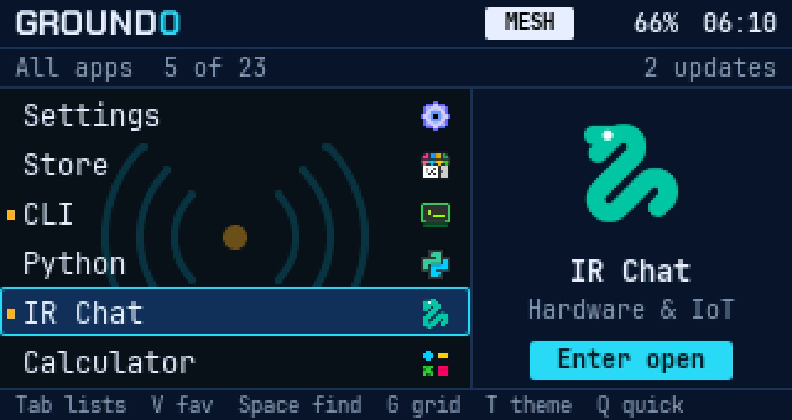
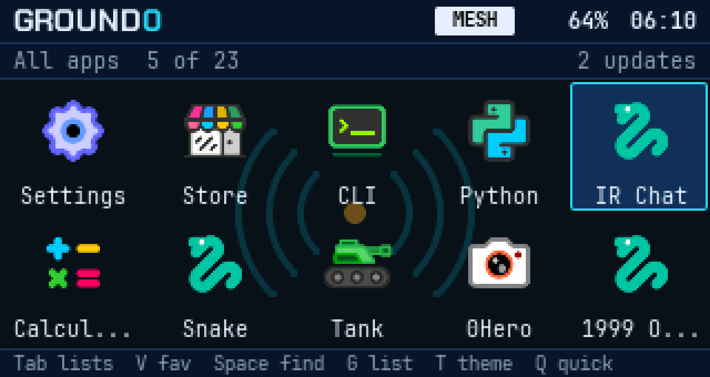
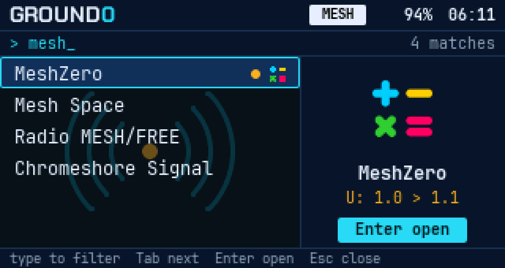
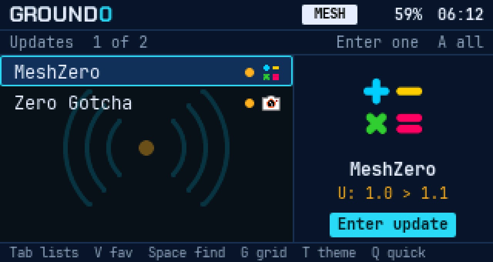
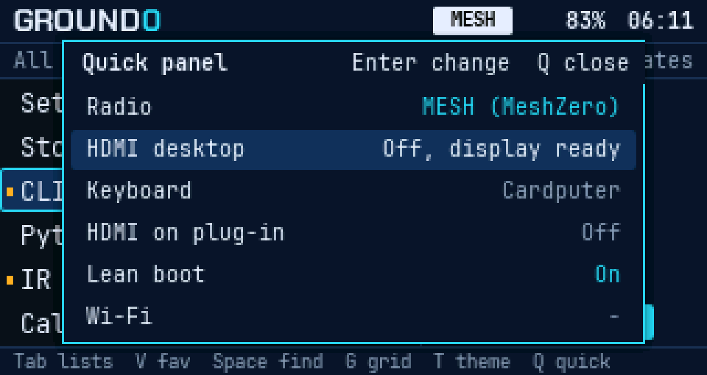
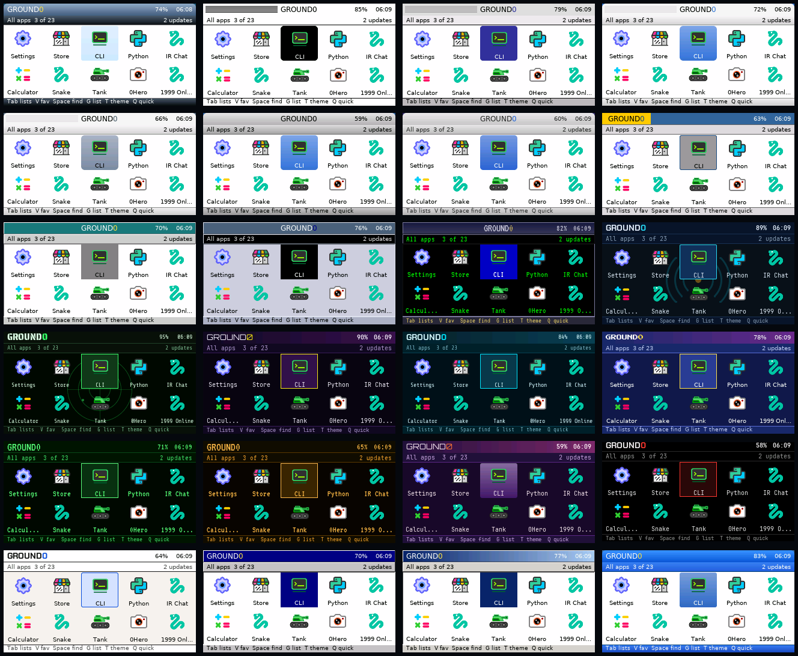

# Ground0

A replacement home screen for the M5Stack **Cardputer Zero**. It runs on the stock launcher's codebase ([CardputerZero/launcher](https://github.com/CardputerZero/launcher), C++ and LVGL 9.5) and swaps the three-icon carousel for a home screen you can drive from the keyboard without scrolling for a minute to find an app.



## What it does

- **List and icon grid.** Six rows with a detail pane, or a 5x2 grid. `G` swaps.
- **Search.** Press `Space` and type. Results cover every app plus commands (switch the radio, start the HDMI desktop, pick a theme by name).
- **Lists.** Favourites, all apps, recents, updates, and one list per store category (Security, Radio & Comms, Hardware & IoT ...). `Tab` cycles.
- **Updates built in.** Apps with a newer store version get a dot. Update one app, or all of them, without leaving the home screen. Uses the 0Hero update engine when it is installed.
- **Radio switch.** One LoRa cap, several programs that want it. A status-bar chip shows whether MeshZero holds the radio (`MESH`) or it is free for apps (`FREE`). Apps that drive the radio themselves stop MeshZero when they open and hand it back when they close.
- **Quick panel.** `Q` opens switches for the radio, the HDMI desktop, the keyboard handover to that desktop, lean boot and Wi-Fi.
- **24 themes.** Ten originals and fourteen classic desktop skins from [1999 Online](https://github.com/GoatsAndMonkeys/1999-online). Themes change chrome, fonts and layout details, not only colours.

| Icon grid | Search |
|---|---|
|  |  |

| Updates | Quick panel |
|---|---|
|  |  |



**[Feature tour with a clip of every feature](ground0/docs/SHOWCASE.md)** · [all clips as one video](ground0/docs/showcase.mp4)

## Keys

The Cardputer Zero has no arrow keys; in the launcher `F` `X` `Z` `C` act as up, down, left, right.

| Key | Action |
|---|---|
| `F` / `X` | Up / down |
| `Z` / `C` | Page up / down (left / right in the grid) |
| `Enter` | Open the app |
| `Space` | Search. `Tab` moves through results, `Esc` closes |
| `Tab` / `Shift+Tab` | Next / previous list |
| `V` | Favourite on / off |
| `G` | List / grid |
| `T` / `Shift+T` | Next / previous theme |
| `M` | Radio: MESH / FREE |
| `U` | Update the selected app |
| `Q` | Quick panel |

In the Updates list `Enter` updates the selected app and `A` updates all.

## Install

Download the `.deb` from the releases page and install it on the device:

```
sudo apt install ./ground0_<version>_arm64.deb
ground0 on
```

Ground0 takes the stock launcher's place in `APPLaunch.service`. The stock launcher is kept beside it (moved aside with `dpkg-divert`, so it still receives its own package updates).

| Command | Effect |
|---|---|
| `ground0 off` | Run the stock launcher |
| `ground0 on` | Run Ground0 |
| `ground0 status` | Show which one is running |
| `sudo apt remove ground0` | Remove Ground0 and restore the stock launcher |

If Ground0 crashes five times within a minute, the stock launcher starts instead until the next boot or `ground0 on`.

The package adds one sudo rule (`/etc/sudoers.d/ground0`) so the radio switch and lean boot work without a password. It allows members of the `sudo` group to start and stop `meshzero.service` and to enable and disable `lightdm.service`, nothing else.

## Optional pieces

| Feature | Needs |
|---|---|
| Updates | 0Hero from the store |
| Radio switch | MeshZero (`meshzero.service`), or any unit named in `ground0_radio_unit` |
| HDMI desktop, keyboard handover | [Desk Mode](https://github.com/InstantComet/cz-desk-mode) from the store |
| Wi-Fi switch | NetworkManager (`nmcli`) |

A row whose piece is missing says so instead of doing nothing.

**Lean boot** stops the Raspberry Pi desktop (LightDM) from loading in the background at boot. On the Cardputer Zero's 352 MB of RAM that desktop holds roughly 50 MB. With Desk Mode installed, the HDMI desktop still starts when you ask for it.

## Settings

Ground0 keeps its settings in the launcher's own config (`~/.config/cardputerzero/config.json`):

| Key | Meaning |
|---|---|
| `ground0_theme`, `ground0_view`, `ground0_tab` | Theme, list or grid, last list |
| `ground0_favs`, `ground0_recent` | App names, `\|`-separated |
| `ground0_radio_unit` | Mesh daemon unit (default `meshzero.service`) |
| `ground0_radio_free` | Apps that need the radio free, comma-separated. Matched against the app name or the file name in its `Exec` line |
| `ground0_radio_mesh` | Apps that need the mesh daemon running |
| `ground0_radio_restore` | `1`: start the daemon again when a free-radio app closes |

## Build

Ground0's code lives in `projects/APPLaunch/main/ui/ground0_*` plus small hooks in the launcher page. The build is the upstream one; see [README.upstream.md](README.upstream.md) for the SDK setup.

```
cd projects/APPLaunch
# simulator (Linux, SDL2)
export CONFIG_DEFAULT_FILE=linux_x86_sdl2_config_defaults.mk CONFIG_REPO_AUTOMATION=1
scons -j8
# device (cross-compile, aarch64)
export CardputerZero=y CONFIG_REPO_AUTOMATION=y
scons -j8
# package
../../ground0/packaging/build-deb.sh dist/M5CardputerZero-APPLaunch 0.1.0
```

Simulator switches for testing without the hardware: `GROUND0_RADIO_SIM=mesh|free`, `GROUND0_DESK_DIR=<folder>`, `GROUND0_HDMI_SIM=1`, `GROUND0_LEAN_SIM=0|1`, `GROUND0_APPS_DIR=<folder>`.

## Credits

- **[CardputerZero/launcher](https://github.com/CardputerZero/launcher)** by M5Stack, MIT. Ground0 is built on it and keeps its settings pages, terminal, app runner and platform layer.
- **[1999 Online](https://github.com/GoatsAndMonkeys/1999-online)** by GoatsAndMonkeys. The fourteen classic skins come from its skin table, used with the author's permission.
- **[Desk Mode](https://github.com/InstantComet/cz-desk-mode)** by InstantComet, MIT. Ground0's HDMI rows drive its daemon.
- **Fonts**, all under the SIL Open Font License: VT323, Press Start 2P, Chakra Petch, Orbitron, Share Tech Mono, Saira Stencil One. Licence texts are in `projects/APPLaunch/APPLaunch/share/font/ground0/`.
- Third-party components of the upstream launcher are listed in [`LICENSES/`](LICENSES/README.md).

The classic skin names are trademarks of their owners and are used only to describe what each skin resembles.

## Licence

Ground0's source code is MIT, the same as the upstream launcher ([LICENSE](LICENSE)).

The **compiled** launcher links one GPL-3.0-only component from upstream (tree.hh), so the binary package is distributed under the GNU GPL version 3, with this repository as its source. The full picture, including the 1999 Online skins and the fonts, is in [ground0/NOTICE.md](ground0/NOTICE.md).
