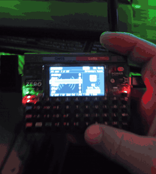
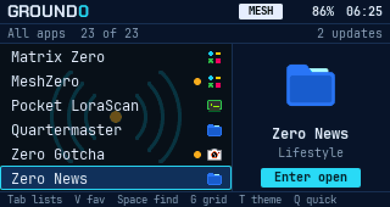
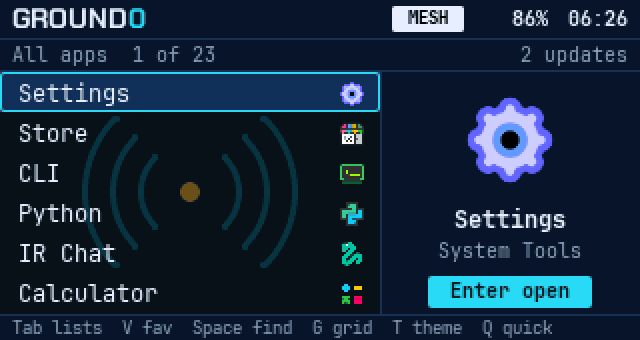
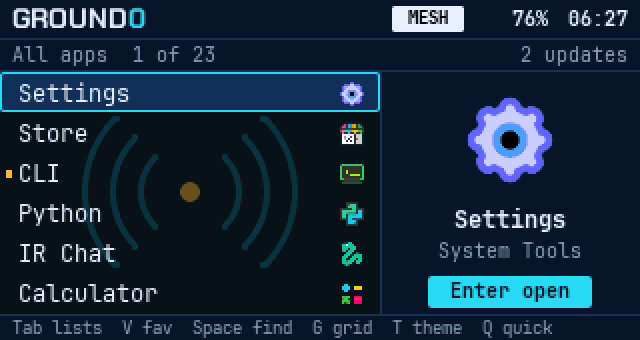
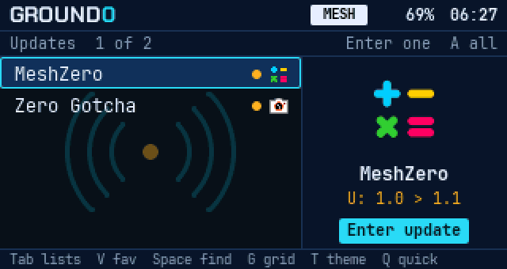
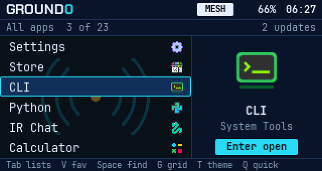
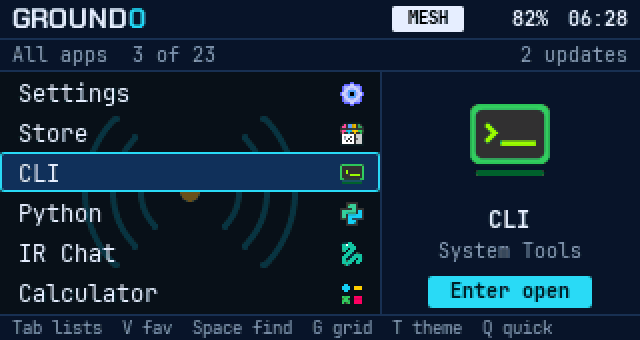
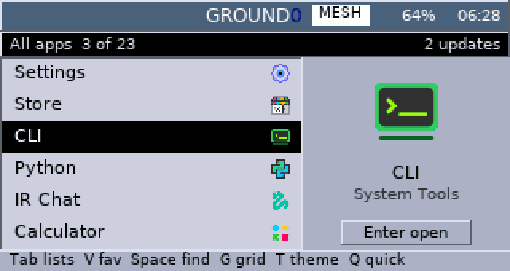
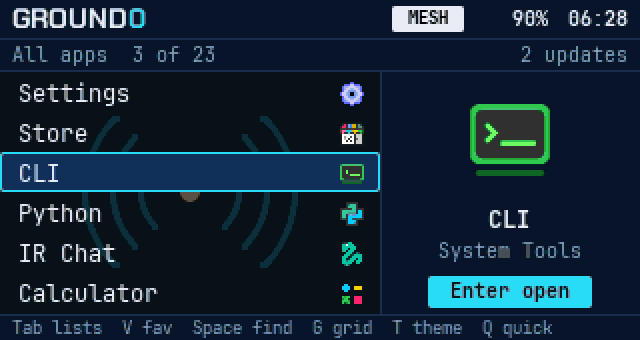

# Ground0 feature tour

A clip of every feature. The simulator clips are at the device's own resolution (320x170, shown at 2x); [`showcase.mp4`](showcase.mp4) is all of them in one video.

## On the device
Ground0 running on a Cardputer Zero: browsing the list and stepping through the lists with `Tab`. Full clip: [`demo-device.mp4`](demo-device.mp4).

The clips that follow are recorded from the simulator build, which runs the same code.

## 1. Browse: list and icon grid
`F` / `X` move, `Z` / `C` page, `G` swaps between the list with its detail pane and the 5x2 icon grid.

## 2. Search
`Space`, then type. `Tab` walks the results, `Esc` closes.

## 3. Commands in search
The same search runs commands: type `theme` to list every theme, or a theme's name to switch to it.

## 4. Lists and favourites
`Tab` cycles Favs, All apps, Recent, Updates and the store categories. `V` marks a favourite.

## 5. Updates
Apps with a newer store version carry a dot. In the Updates list `Enter` updates one app and `A` updates all; `U` updates the selected app from any list.

## 6. Radio switch
`M` hands the LoRa radio between MeshZero (`MESH`) and apps that drive it themselves (`FREE`).

## 7. Quick panel
`Q` opens the switches for the radio, the HDMI desktop, the keyboard handover, lean boot and Wi-Fi.

## 8. Themes
`T` steps through all 24. Each theme sets its own chrome, fonts and corner style.

